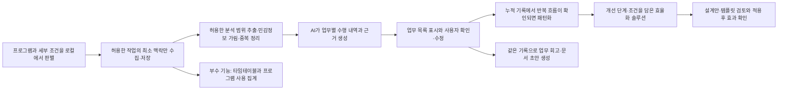

# WorkMemory AI 제품·AI 설계 메모

제출용 본문은 [AX-hackathon-proposal.md](AX-hackathon-proposal.md)에 있습니다. 이 문서는 선택한 범위의 데이터를 자동으로 모아 업무별 수행 내역을 먼저 보여주고, 누적된 기록에서 반복 흐름이 확인되면 개선 방법을 제안하는 서비스의 개발·검증 계획입니다. 정리된 기록은 업무 회고와 문서 작성에도 활용합니다. 아래 기능과 데이터 구조는 해커톤에서 개발하고 검증할 설계안입니다.

## 1. 제품 방향과 핵심 사용자 경험

**나의 업무를 정리하고 회고와 효율화를 돕는 AI 업무 비서입니다.**

주요 대상 사용자는 PC로 일하는 SDS 임직원입니다. 사용자가 허용한 범위에서 평소 업무 데이터가 자동으로 쌓이면, AI가 관련 작업을 연결해 어떤 일을 했는지 업무별 수행 내역으로 먼저 보여줍니다. 기록이 누적되면 비슷한 목적과 처리 순서가 반복되는 흐름을 찾아 묶으며, 이를 업무 패턴화라고 합니다. 반복 흐름이 확인되면 해당 단계를 줄이거나 자동화할 구체적인 개선 방법, 즉 업무 효율화 솔루션을 제안합니다.

개선 방법은 처리 단계·입출력 조건을 정리한 자동화 설계안이나 반복 사용할 공통 양식인 템플릿으로 제공합니다. 같은 업무 기록은 자신의 일을 돌아보는 회고와 일일·주간·월간 보고, 필요시 평가 노트 등 문서 작성의 근거로도 활용합니다. 문서 작성은 정리된 업무 기록으로 바로 시작할 수 있습니다. 시간대별 활동 흐름을 보여주는 타임테이블과 프로그램 사용 현황은 부수 기능입니다.

업무명·수행 내용·분류·관련 기록을 하나로 묶은 요약 화면을 업무 카드라고 부릅니다. 기본 화면에서는 이 카드들을 업무별 수행 내역 목록으로 보여줍니다.

| 단계 | 사용자 경험 | 시스템의 책임 |
| --- | --- | --- |
| 선택적 기록 | 프로그램·파일·대화·사이트 조건 설정, 기록 시작·중지 | 사용자 PC에서 허용 여부를 먼저 판별하고 필요한 작업 정보만 자동 축적 |
| 수행 내역 표시 | 오늘 어떤 일을 했는지 업무별 목록과 관련 근거 확인 | 관련 작업을 업무 성격에 따라 연결·분류하고 업무명·수행 내용 표시 |
| 확인 | 하루 목록에서 이름·분류 수정과 무관한 연결 제외 | 원본을 유지하며 확인 상태와 수정 이력 저장 |
| 누적 기록의 패턴화·솔루션 | 반복 흐름이 확인될 때 개선 방법을 검토하고 채택·수정·보류 | 비슷한 목적·순서의 반복을 묶고 근거·개선 단계·적용 조건을 담은 제안 제공 |
| 같은 기록의 회고·문서 활용 | 기간별 업무 회고, 결과·기여·다음 계획 보완, 초안 저장·내보내기 | 정리된 기록을 근거로 선택 서식의 초안 생성. 반복 흐름 발견 여부와 독립적으로 제공 |
| 부수 집계 | 시간대별 업무 흐름과 자주 사용한 프로그램 확인 | 허용 범위의 타임테이블·관측 사용 시간·업무별 시간 추정 제공 |

업무 카드에서는 요약한 수행 내역을 먼저 보여주고 관련 원본 기록은 필요할 때 펼치도록 합니다. 사용자는 목록을 한 번 검토하고 선택한 카드 묶음을 확인합니다. 시스템은 모호한 연결이나 제목에 필요한 질문만 제시합니다. 개별 조작 기록마다 확인을 요구하지 않습니다. 합치기·분리 등의 고급 편집은 선택 구현으로 둡니다.

‘미처 기록하지 못한 업무’는 로그만으로 사용자의 기억을 판단해 자동 확정하지 않습니다. 기억과 대조하는 목록은 시연·평가에서 사용하고, 일상 사용에 별도 일지를 요구하지 않습니다. 사용자에게 새롭게 드러난 반복 흐름과 실제 기억에서 빠진 업무를 구분해 평가합니다.

## 2. 활용할 기술과 개발 계획

선택적 수집·저장과 업무별 수행 내역 표시를 먼저 연결한 뒤, 누적 기록의 반복 흐름에 대한 개선 제안과 같은 기록을 활용한 일일 보고 초안을 하나의 시제품으로 개발할 계획입니다. 이처럼 핵심 기능을 검증하는 최소 구현 제품을 MVP라고 부릅니다. 제품의 적용 대상은 PC 업무 전반으로 두고, 2일 시연에서는 두 개 이상의 프로그램을 오가는 대표 업무 한 가지를 검증합니다. 첫날 수집 조건의 판별 가능성을 확인해 시연 환경과 앱 조합을 선정합니다.

작업 시각·클릭·앱 전환처럼 관측한 하나의 조작 기록을 이벤트라고 부릅니다. 로컬은 사용자 PC 내부를 뜻하며, 로컬 DB는 이러한 기록을 PC 내부에 보관하는 데이터베이스입니다. AI 분석에는 대규모 언어 모델에 분류·요약을 요청하는 연결 방식인 LLM API를 활용합니다. 앱이 제공하는 화면 요소 정보를 읽는 접근성 API와, 자료를 항목명·값으로 주고받는 JSON 형식도 사용합니다.

| 개발 항목 | 활용할 기술 | 구현할 기능과 범위 |
| --- | --- | --- |
| 수집 조건 판별 | 프로그램 허용 목록, 접근성 API, 브라우저 확장·앱 연동 | 최소 식별 정보로 앱·파일명 키워드·대화 상대·사이트 조건을 로컬에서 평가 |
| PC 조작 기록 수집 | 운영체제의 키보드·마우스 이벤트, 활성 앱 관측 | 허용한 작업의 조작 시각·종류와 전환 맥락만 수집, 시작·중지 제공 |
| 업무 맥락 수집 | 접근성 API, 필요 시 브라우저 확장·앱 연동 | 허용 조건을 통과한 작업에서 필요한 대상·문서·페이지 맥락만 확보 |
| 수집 모듈과 화면 | 운영체제별 수집 어댑터, 데스크톱 UI | 공통 이벤트 형식과 업무 카드·분류·근거·확인 화면 개발 |
| 기록 저장 | SQLite 등 로컬 DB | 원본 이벤트, 업무 카드, 분류, 사용자 수정·확인과 초안 저장 |
| AI 분석 | LLM API, 주기 실행, JSON 응답 검증 | 업무별 수행 내역 생성·표시, 누적 기록의 패턴화·개선 제안, 같은 기록의 문서 초안 생성 |
| 자료 선택과 보호 | 수집·전송 허용 분리, 민감정보 가림, 운영체제 계정 기반 보호 | 저장 전 조건 적용, 외부 전송 최소화, 로컬 원문과 파생 데이터 삭제 |
| 부수 집계 | 시각·활동 구간의 코드 기반 계산 | 타임테이블·프로그램별 관측 시간과 사용 비중, 근거가 있는 업무별 시간 추정 |

수집 항목에는 이벤트 ID, 발생 시각, 허용한 프로그램·문서·페이지 식별자, 조작 종류, 입력·클릭 대상과 수집 상태를 포함할 계획입니다. 연속 키 입력 원문은 기본 수집하지 않습니다. 단순 입력 횟수·마우스 좌표에서 업무를 단정하지 않고, 확보한 맥락을 근거로 연결·분류합니다. 원본과 분석 결과를 연결할 수 있도록 식별자와 시각을 함께 저장합니다.

기밀 없는 스프레드시트·문서·테스트 페이지를 준비하고, 자료 취합·정보 확인·문서 정리의 흐름을 검증할 계획입니다. Windows를 시연 환경으로 선정하면 입력 이벤트 관측과 Windows의 화면 요소 정보를 읽는 UI Automation과 .NET 기반 데스크톱 화면 등을 기술 후보로 검토합니다. 브라우저에서는 페이지의 요소 구조인 DOM을 관측해 세부 맥락을 보완하는 방안을 검토합니다. 다양한 앱·운영체제의 호환성과 하루 연속 기록은 후속 검증 대상으로 둡니다.

수집 설계의 범위는 다음과 같습니다.

- 기본 상태에서는 수집하지 않습니다. 사용자가 프로그램을 선택하고 필요시 파일명 키워드·대화 상대·사이트 조건을 추가합니다. 설정한 프로그램과 세부 조건을 함께 만족해야 하며 제외 조건을 우선합니다.
- Excel은 ‘프로젝트 A’가 들어간 파일만, 메신저는 지정한 업무 상대·대화방만, Chrome은 지정한 업무 도메인·경로만 허용하는 방식을 목표로 합니다. 앱별 지원 여부를 표시합니다.
- 허용 여부를 판별하는 최소 식별 정보만 로컬에서 일시적으로 확인하고, 허용한 작업에서만 상세 맥락을 읽고 저장합니다. 비허용 파일명·상대·사이트를 원본·디버그 로그·모델 입력에 남기지 않습니다.
- 앱·파일·대화방·탭 전환 시 조건을 다시 평가합니다. 식별 실패·권한 부족·조건 불명확 시 수집을 중지하고, 이전 대상의 허용 상태를 그대로 적용하지 않습니다. 조건이 미지원이면 프로그램 전체 수집으로 자동 전환하지 않습니다.
- 전체 URL·쿼리, 클립보드, 화면, 전체 페이지 내용과 읽기 전용 대화 내역은 기본 수집 대상에서 제외합니다.
- 비밀번호·인증정보 입력은 제외하고, 일시중지와 현재 수집 상태 확인·전체 삭제를 제공합니다.
- 두 개 이상의 시연 프로그램에서 입력·클릭·전환 맥락을 관측하고, 앱별 지원 범위와 수집 공백을 표시합니다.
- 운영체제별 수집 모듈은 같은 이벤트 형식으로 변환합니다. 접근성 정보와 앱 연동의 관측 가능 범위는 구현 중 검증합니다.
- 터미널의 프롬프트 내용, 상대방의 요청 내용, 실제 처리 결과가 로그에 있다고 가정하지 않습니다.
- 값 변경·클릭·폼 제출 관측만으로 사용자의 의도, 전송 성공, 업무 완료와 문제 해결을 확정하지 않습니다.

## 3. 분석 처리 흐름

### 기록 추출과 정리

분석은 수집 경로와 분리해 실행하고, 해당 시점의 입력 자료와 버전을 기록합니다. 사용자가 선택한 기간·프로그램·사이트에 해당하는 데이터만 읽습니다. 시간은 협정 세계시인 UTC를 기준으로 저장하고 선택한 지역 시간대의 일·주·월 경계로 조회·표시합니다.

MVP는 짧은 테스트 구간의 전체 기록을 조회하는 저장소를 구현할 계획입니다. 분석할 기록의 건수를 먼저 확인하고, 한 번에 처리할 수 있는 범위를 넘으면 기간을 줄이도록 안내합니다. 추출 건수와 원본 건수를 대조하고 분석 날짜·범위를 표시합니다. 실제 한 주 전체와 장기 기록으로 확장할 때는 이전 조회의 마지막 위치부터 다음 기록을 가져오는 커서 기반 페이지 조회를 검토하고, 같은 시각의 이벤트 ID까지 정렬 기준에 포함합니다. 대량 원본을 한 번에 모델에 전달하지 않습니다.

이벤트 ID로 중복을 제거하고, 입력 필드·문서·맥락과 시각을 이용해 연속 수정본을 묶습니다. 최종 관측값이 실제 전송값이라고 가정하지 않습니다. 줄이거나 묶은 이벤트와 원본의 연결을 유지하고, 동일한 입력 문구라도 다른 요청일 가능성을 남깁니다.

### 업무별 수행 내역 표시와 확인

조작의 시간적 근접성, 앱·문서·페이지 전환과 기록 세션 식별자를 이용해 분석 구간을 만들 계획입니다. AI가 각 구간에서 업무 후보·분류·연결 이유를 제안하고, 다른 프로그램의 기록도 관련 근거가 있을 때 함께 제시합니다. 같은 프로젝트 이름이 등장해도 자료 작성과 개발 오류 수정처럼 목적이 다른 일은 구분합니다.

이렇게 연결한 결과는 업무명·업무 분류·수행 내용·근거 ID·연결 이유·확인이 필요한 내용을 담은 카드로 만들어 목록에 먼저 표시합니다. AI가 제안했지만 아직 사용자가 확인하지 않은 연결은 업무 후보로 표시합니다. 분류는 자료 작성·분석·개발·검토·협업 등을 제안하고 사용자가 수정할 수 있게 합니다. 출처가 없는 사실과 존재하지 않는 ID는 검증 단계에서 거부합니다. 유효한 ID가 있어도 문장의 해석이 맞는지는 별도로 검토합니다. 수집 불가·잘림·유실 상태가 있는 자료는 해당 제한을 유지합니다.

사용자는 후보의 이름·분류를 고치고 잘못 연결된 근거·카드를 제외한 뒤, 선택한 카드 묶음을 확인합니다. 이 수정·확인 내용의 저장을 필수로 구현합니다. 합치기·분리와 미수집 업무 추가는 확장 기능이며, 사용자 입력으로 추가한 업무는 출처를 구분합니다. 재분석 시 사용자가 정한 업무명·분류·묶음·확인 상태를 자동으로 덮어쓰지 않습니다.

### 업무 패턴화·효율화 솔루션과 문서 생성

수행 내역이 누적되면 업무 카드를 기준으로 기간별 패턴 분석을 수행합니다. 비슷한 목적·순서·데이터 이동의 반복이 확인되면 공통 흐름으로 패턴화하고, 사용자 확인을 거쳐 묶음별 업무 수를 계산합니다. 미확인 패턴은 후보로 표시하며, 키 입력 수정본·클릭 수를 처리 건수로 사용하지 않습니다.

반복 흐름을 개선할 방법은 별도의 솔루션 카드로 제공하며, 대상 업무·반복 근거·개선 단계·입출력 조건·적용 방법·사람이 확인할 예외를 담습니다. 예를 들어 파일 취합 반복에는 공통 열 정의, 통합·중복 확인·서식 적용 단계와 양식 예시를 제시합니다. MVP는 실제 짧은 반복 작업 한 가지의 자동화 설계안 또는 템플릿을 제공합니다. 사용자의 채택·수정·보류를 저장하며, 자동화 실행과 실제 절감 효과 검증은 후속 단계로 둡니다.

정리된 기록은 패턴 분석과 별개로 업무 회고와 문서 생성에 활용합니다. 문서 초안은 확인된 수행 내역과 사용자가 보완한 결과·이슈·기여·다음 계획·개선 시도를 입력으로 생성합니다. MVP는 기간별 업무 조회와 일일 보고 한 서식, 업무 항목별 카드·원본 연결을 제공할 계획입니다. 실제 입력에 포함된 날짜·프로그램·분석 범위를 표시합니다. 장기 활용에서도 업무 ID와 근거를 유지하고, 주간·월간 보고·다양한 문서 서식과 정기 자동 생성은 확장 항목으로 둡니다. 여러 날 이어진 업무를 하나의 주제로 묶더라도 별도 발생한 업무의 건수와 혼동하지 않게 합니다.

업무 묶음을 확인했다는 사실만으로 업무가 완료됐다고 보지 않습니다. 실제 결과·완료 여부·기여·다음 계획·효과는 관련 근거가 있거나 사용자가 확인·보완했을 때 문서에 포함합니다. 미확인 후보는 보고 본문과 분리하고, 부족한 내용은 보완 항목으로 제공합니다.

## 4. 부수 기능: 타임테이블과 프로그램 사용 현황

시각·앱 전환·업무 분류를 활용해 시간대별 타임테이블, 프로그램별 관측 사용 시간과 사용 비중, 업무별 시간 추정치를 제공할 수 있습니다. 이 기능은 자신의 일하는 방식을 돌아보고 효율화 솔루션을 검토하기 위한 참고 자료입니다. 프로그램 사용 구간을 특정 업무의 실제 투입 시간과 같다고 보지 않고, 이벤트 사이의 경과 시간을 전부 업무 시간으로 더하지 않습니다.

MVP의 첫 결과는 자동 분류한 업무별 수행 내역 목록입니다. 여기에 누적 기록의 반복 흐름에 대한 효율화 솔루션 한 개, 같은 기록을 활용한 업무 회고와 일일 보고 초안을 연결합니다. 타임테이블과 프로그램 집계는 여유가 있을 때 시연합니다. 정교한 업무별 시간 배분은 후속 검증 대상으로 두고, 근거가 되는 활동 구간과 사용자 확인이 있을 때만 추정합니다. 유휴·다른 업무로의 전환·수집 공백을 고려하고, 겹치는 업무에 시간을 중복 배분하지 않습니다. 배분할 근거가 부족한 구간은 미분류로 남깁니다.

활동 구간은 날짜 경계에서 잘라 집계하며 복구·관측 실패 상태를 보존합니다. 선택 범위 밖의 구간은 미수집으로 표시하고, 제외한 앱·파일·대화·사이트의 정체를 복원해 기록하지 않습니다. 프로그램 사용 비중의 분모는 허용 범위에서 관측한 활동 시간으로 두고 수집 범위를 함께 표시합니다. 입력이 없는 독서·생각·회의와 오프라인 업무가 있으므로 유휴·미기록 구간을 업무하지 않은 시간으로 해석하거나 전체 근무시간·개인 생산성 점수로 환산하지 않습니다.

## 5. 설계할 데이터 구조

수집할 원본 이벤트와 분석·확인·보고 데이터를 구분해 저장할 계획입니다. 다음은 후속 확장까지 포함한 개념 모델이며, MVP는 원본 이벤트·업무 카드·근거·간단한 수정 및 확인·보고 저장을 우선 구현합니다.

| 저장 항목 | 주요 내용 | 연결 |
| --- | --- | --- |
| 수집·전송 설정 | 허용 앱·파일명 키워드·대화 상대·사이트, 제외 조건, 분석 주기·외부 전송 허용 | 사용자 설정 버전과 앱별 지원 범위 |
| 원본 이벤트 | 허용한 작업의 시각, 프로그램·문서·페이지, 조작 종류와 대상, 수집 상태 | 기록 세션·이벤트 ID·적용 설정 버전 |
| 분석 실행 | 기간, 시간대, 대상, 입력 자료 버전, 모델·프롬프트 버전, 상태·실패 사유 | 사용한 원본 ID와 데이터 범위 |
| 업무 카드 | 제목·분류·요약, 관련 시각, 출처, 후보·확인·제외 상태 | 원본 이벤트·활동 구간, 분석 실행 |
| 업무 근거 | 해당 업무와 연결한 이유, 자료의 관측·사용자 입력 구분 | 업무 카드와 원본 ID |
| 사용자 수정 | 변경 전후, 합치기·분리·제외, 수정 시각, 사용자 보완 내용 | 업무 카드와 이전 버전 |
| 반복 묶음·효율화 솔루션 | 패턴, 구성 업무, 개선 단계·적용 조건·설계안·템플릿, 채택·수정·보류 | 업무 카드 ID와 근거 |
| 회고·문서 초안 | 기간·서식·업무·결과·기여·이슈·다음 계획·개선 시도, 검토 상태·버전, 보완 항목 | 입력 업무 카드 버전, 사실 문장별 근거 |
| 부수 시간 집계 | 시간대별 활동 구간·프로그램 사용 시간·업무별 시간 추정, 미분류·미수집 상태 | 허용한 원본·활동 구간·업무 카드와 집계 기준 |

모델의 출력은 구조화된 형식으로 받아 원본 ID의 존재·대상 범위·중복·기간을 검사합니다. 사용자가 수정한 문장도 수정 이력과 함께 보존하고, 모델 생성 내용과 구분합니다. 확인하지 않은 수치형 신뢰도를 정확도처럼 표시하는 대신 확인 상태와 해석 근거를 보여줍니다.

## 6. 모델 연결과 자료 선택

LLM API 호출 기능으로 허용한 기록을 업무별 수행 내역으로 먼저 정리할 계획입니다. 이후 누적된 기록에 반복 흐름이 확인되면 개선 방법을 제안하며, 정리된 기록은 회고와 보고 초안 작성에도 활용합니다. 수집과 AI 분석을 분리하고, 최초에 사용자가 설정한 분석 주기·자료 범위·외부 전송 허용 안에서 자동 분류를 실행합니다. 수동 재분석도 제공하되 사용자 수정·확인 내역은 보존합니다. MVP에서는 접속 가능한 모델 하나로 실제 응답과 구조화 결과를 검증합니다. 사내 자료에는 해당 환경에서 사용할 수 있는 모델을 적용하고, 로컬 모델 지원은 실행 환경·속도·품질 확인 후 확장합니다.

사용자는 프로그램뿐 아니라 파일명·대화 상대·사이트 조건으로 수집 범위를 제한하고, 분석할 기간·전송 자료를 별도로 선택할 수 있게 합니다. 수집 조건은 저장 전에 적용하고 전송 전에 다시 범위를 검증합니다. 민감 필드 제외와 값 패턴 기반 가림 처리를 적용하고, 실제로 모델에 보낼 입력 자료를 미리 볼 수 있게 할 계획입니다. 이 처리가 모든 기밀을 판별한다고 가정하지 않습니다. 분석 결과와 오류 로그에도 불필요한 원문을 남기지 않습니다. 세부 보관 기간 설정은 확장 기능으로 검토합니다.

입력값과 요소 라벨은 분석할 데이터로 취급합니다. 로그에 포함된 지시문이 시스템 동작이나 자료 접근 범위를 바꾸지 못하게 하며, 모델에 외부 전송·프로그램 조작 도구를 부여하지 않습니다. 솔루션은 제안·설계안·템플릿으로 제공하고, 보고서는 사용자가 검토한 뒤 저장·내보냅니다. 개인 원본은 자동으로 조직에 공유하지 않으며 사용자가 고른 요약만 공유할 수 있도록 합니다.

원본과 별도로 분석 입력, 업무 카드·수정 이력·패턴·솔루션·문서·시간 집계에도 보관·삭제 정책을 적용합니다. 전체 기록 삭제는 파생 데이터와 분석 입력 사본을 함께 처리합니다. 원본의 보관 기한이 끝나 근거를 다시 열 수 없으면 ‘원본 만료’ 상태를 표시하고, 더 긴 기간의 업무·보고 보존은 사용자가 선택하도록 설계합니다. 사용자가 내보낸 파일은 별도 사본임을 명확히 합니다.

## 7. 2일 구현 순서와 범위

| 시점 | 작업 | 완료 기준 |
| --- | --- | --- |
| 1일 차 전반 | 앱 조합·허용 조건 선정, 로컬 조건 판별과 맥락 수집·저장 | 두 개 이상의 프로그램에서 허용 기록 수집, 비허용 작업 저장 차단 |
| 1일 차 후반 | LLM API·주기 실행 연결, 업무별 수행 내역 목록과 짧은 수정·확인 | 관련 작업을 업무별로 연결·분류해 표시하고 이름·분류·연결 수정 저장 |
| 2일 차 전반 | 누적 기록의 패턴화·개선 제안 한 개, 같은 수행 내역을 활용한 일일 보고 초안 | 실제 반복 작업의 근거와 개선 방법 제시, 확인한 업무로 초안 생성 |
| 2일 차 후반 | 저장·내보내기, 개인정보 수집 조건과 핵심 오류 검증·시연 | 수집·수행 내역 표시를 먼저 시연하고 반복 흐름의 개선 제안·같은 기록의 문서 활용 제시. 여유가 있으면 시간 집계 시연 |

1일 차 오전에는 앱별 관측 범위와 수집·저장 경로를 확인하고, 오후에는 실제 모델의 업무 연결·분류를 검증할 계획입니다. 여러 도구에서 이어지는 같은 업무와, 같은 프로젝트이지만 목적이 다른 업무를 비교합니다. 맥락이 부족하면 테스트 업무와 수집 방법을 조정합니다. 실시간 분석이 실패할 때 저장된 결과는 명확히 표시한 보조 시연으로만 쓰며 실제 동작 완료로 계산하지 않습니다.

수집 전 허용 조건 적용, PC 조작·앱 전환 맥락 수집과 로컬 저장을 필수 개발 범위에 포함합니다. 특정 프로그램 조합은 해커톤 시연의 선택이며, 제품의 대상 직무와 도구 범위는 PC 업무 전반으로 유지합니다. 원본·분류·수정·솔루션·보고 초안은 로컬 DB에 저장하고 시연 환경에 맞는 데스크톱 UI를 개발할 계획입니다.

업무별 수행 내역 표시가 첫 핵심 구현 목표이며, 기록을 바탕으로 반복 패턴·효율화 솔루션 한 개와 일일 보고 초안을 연결합니다. 파일명·사이트 조건은 시연 앱에서 지원 가능한 범위를 선정하고, 메신저 대화 상대 등 추가 세부 필터는 연동 가능성 확인 후 확장합니다. 타임테이블·프로그램 집계는 선택 시연, 정교한 업무별 시간 배분·주간·월간 보고·다양한 서식·고급 합치기·분리·문장별 상세 근거·정기 문서 생성은 확장 항목입니다. 앱·운영체제의 지원 범위와 솔루션의 실제 효과는 후속 사용을 통해 검증합니다.

## 8. 대표 시연 자료와 검증

실제 테스트 작업과 별도로 여러 날에 걸친 가상 이벤트·확인 업무를 준비합니다. 실제 수집과 가상 자료의 화면·출처를 구분합니다. 가상 기록에 없는 화면 내용·수신 메시지·처리 결과를 AI가 입력으로 알고 있다고 가정하지 않습니다.

| 검증 사례 | 확인할 결과 |
| --- | --- |
| 같은 필드의 연속 수정과 재클릭 | 여러 이벤트가 곧바로 여러 업무 건수가 되지 않음 |
| 서로 다른 업무에 같은 프로젝트 이름 등장 | 동일 문구만으로 업무를 자동 병합하지 않음 |
| 두 개 이상의 프로그램에서 관련 조작 관측 | 어떤 업무를 했는지 수행 내역 목록을 먼저 표시하고, 분류·근거 확인과 잘못된 연결 수정 가능 |
| 전송 클릭·폼 제출만 관측 | 전송 성공·업무 완료·문제 해결을 만들어 쓰지 않음 |
| 미지원 앱, 잘린 입력, 수집 공백 | 분석 범위와 확인 필요 상태를 유지 |
| 분석 가능한 기록 건수 초과 | 원본·추출 건수 일치, 초과 시 기간 축소 안내. 장기 확장 시 동일 시각을 포함한 페이지 경계도 검증 |
| 자정·주·월 경계를 넘는 기록 | 선택한 시간대와 기간에 맞게 조회하고 중복 집계하지 않음 |
| 사용자가 수정한 업무를 재분석 | 확인한 이름·묶음이 보존되고 보고에 반영됨 |
| 반복 흐름이 없는 업무로 문서 생성 | 정리된 기록만으로 초안을 생성하고 결과·기여·다음 계획의 부족한 근거는 보완 항목으로 표시 |
| 업무 기록에 반복 파일 취합·문서 입력 흐름이 누적 | 확인된 패턴의 근거와 개선 단계·적용 조건이 담긴 설계안 또는 템플릿 제시 |
| 같은 앱의 허용·비허용 파일과 사이트를 교차 사용 | 비허용 입력과 식별 정보가 원본·오류 로그·모델 입력에 남지 않음 |
| 지정한 메신저 대화에서 다른 대화방으로 전환 | 지원 앱에서 조건을 다시 판별하고, 비허용 대화는 내용 읽기·저장 전에 차단 |
| 허용·제외 조건 충돌 또는 식별 실패 | 제외 우선, 판별 불가 시 미수집. 이전 대상 허용 상태를 재사용하지 않음 |
| 수집 허용 상태에서 외부 전송은 해제 | 로컬 기록만 유지하고 자동 분석을 위한 외부 호출은 실행하지 않음 |
| 부분 수집·유휴·동시 구간의 시간 집계 | 수집 범위와 미분류·미수집 구간 표시, 중복 합산 없음 |
| 로그에 들어 있는 ‘지시문’ | 분석 자료로만 취급하고 동작·접근 범위를 바꾸지 않음 |
| 모델 오류·취소·잘못된 구조·존재하지 않는 ID | 실패를 표시하고 원본·사용자 확인 데이터를 유지 |
| 전체 삭제와 원본 만료 | 파생 데이터 처리와 근거 상태가 설정에 맞게 반영됨 |

저장된 결과를 시연할 경우 저장된 분석임을 표시합니다. 로컬 통계나 템플릿 출력을 실제 모델 응답으로 제시하지 않습니다. 보고 문장에서 업무 카드와 유효한 원본으로 돌아갈 수 있는지 확인합니다.

## 9. 효과 측정과 후속 검증

| 측정 항목 | 방법 | 해석 범위 |
| --- | --- | --- |
| 업무 복원 품질 | 사용자 기준 업무와 카드의 대응, 잘못된 묶음·누락, 수정 횟수·소요 시간 확인 | 관측 가능한 테스트 업무에서 평가 |
| 놓친 업무 발견 | AI 보기 전 목록에 없던 업무 중 사용자가 실제 수행했고 유용하다고 확인한 항목 집계 | AI가 만든 카드 수와 구분 |
| 문서 자동화 효율 | 수동 작성과 AI 초안의 확인·수정·결과·기여·다음 계획 보완까지 총시간 비교, 최초 설정 시간 별도 기록 | 일일 보고 초안 검증과 장기·다양한 서식의 효과를 구분 |
| 효율화 솔루션 유용성 | 유효한 반복 패턴, 개선 단계·적용 조건의 실행 가능성과 채택·보류 이유 확인 | 제안 채택과 실제 개선 효과를 구분 |
| 보고의 근거 품질 | 사실 문장별 근거, 과장된 완료·성과·수치 확인 | ID 연결과 내용의 타당성을 함께 검토 |
| 부수 시간 집계 품질 | 테스트 구간과 타임테이블·프로그램 관측 시간 비교, 중복·유휴·미수집 처리 확인 | 허용한 관측 범위 안에서만 해석 |
| 선택적 수집 보호 동작 | 같은 앱 안에서 허용·비허용 작업을 섞고 저장·로그·외부 전송 자료 대조 | 구현한 앱·조건의 차단 여부를 검증하고 미지원 범위를 표시 |

계획된 시연은 기능 동작과 복원 품질의 검증으로 한정하고, 실제 기억 누락과 시간 절감은 별도의 사용자 작업으로 검증합니다. 비교 작업의 순서를 바꾸거나 유사한 별도 자료를 사용해 앞선 작성 경험의 영향을 줄입니다. 실제 업무의 누락 여부는 로그만으로 판정하지 않고 사용자 기준 목록과 선택적 설명을 함께 봅니다.

조직 효과는 사용자가 선택해 공유한 업무 요약이 반복 수작업의 표준화·자동화 검토 우선순위를 설명하는 데 도움이 되는지 확인합니다. 이를 위해 팀 원본 수집이나 팀 분석을 MVP에 추가하지 않습니다.

장기적으로는 제안한 안내문·체크리스트·자동화를 실제로 사용했는지, 반복 부담에 어떤 변화가 있었는지 확인합니다. 요청량·업무 구성·수집 범위가 바뀔 수 있으므로 기록 건수 감소만으로 효과를 확정하지 않습니다.
