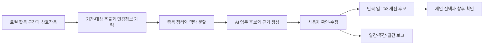

# WorkMemory AI 제품·AI 설계 메모

제출용 본문은 [AX-hackathon-proposal.md](AX-hackathon-proposal.md)에 있다. 이 문서는 기존 `work-memory`를 활용해 작업 로그를 업무 기억으로 바꾸는 구현 범위와 검증 방법을 정리한다.

## 1. 제품 방향과 핵심 사용자 경험

**나도 몰랐던 나의 일을 찾아주는 AI 업무 기억 비서.**

첫 사용자는 조회·문의 응답 작성과 주간보고를 반복하는 사내 시스템 운영·지원 담당자다. 하루의 로그를 업무 후보로 복원해 빠뜨린 일을 확인하고, 개별 행동으로만 인식했던 조회·안내가 반복 지원업무였다는 점을 발견하도록 돕는다. 확인한 업무를 보고에 재사용하고, 누적된 기록의 반복 흐름을 개선 후보로 연결한다.

| 단계 | 사용자 경험 | 시스템의 책임 |
| --- | --- | --- |
| 기록 | 수집 범위를 정하고 기록 시작·중지 | 현재 지원하는 방식으로 활동·상호작용을 로컬 저장 |
| 복원 | 오늘의 업무 후보와 근거 확인 | 입력·클릭·맥락을 연결해 업무 후보 구성 |
| 확인 | 하루 목록에서 이름 수정·무관한 연결 제외, 선택한 카드 묶음 확인 | 원본을 유지하며 확인 상태와 수정 이력 저장 |
| 발견 | 잊었던 일을 떠올리고 반복 흐름 확인 | 확인된 업무의 유사성·반복과 개선 후보 제안 |
| 보고 | 기간 선택, 초안 검토·수정·내보내기 | 확인 업무와 사용자 보완 내용으로 근거가 연결된 보고 생성 |

기본 화면은 원본 이벤트가 아닌 업무 카드 목록이다. 사용자는 목록을 한 번 검토하고 선택한 카드 묶음을 확인한다. 원본은 필요한 카드에서만 펼치고, 시스템은 모호한 연결이나 제목에 필요한 질문만 제시한다. 개별 이벤트마다 확인을 요구하지 않는다. 합치기·분리 등의 고급 편집은 선택 구현으로 둔다.

‘미처 기록하지 못한 업무’는 로그만으로 사용자의 기억을 판단해 자동 확정하지 않는다. 기억과 대조하는 목록은 시연·평가에서 사용하고, 일상 사용에 별도 일지를 요구하지 않는다. 사용자에게 새롭게 드러난 반복 흐름과 실제 기억에서 빠진 업무를 구분해 평가한다.

## 2. 현재 활용할 구현 기반

확인 대상은 `C:\playground\work-memory`의 문서와 소스다. 아래는 소스·문서 확인 기준이며 이번 기획 작업에서 수집기 실행이나 실제 AI 모델 연결을 새로 검증하지 않았다.

| 항목 | 현재 확인한 내용 | 이번 구현에서의 활용 |
| --- | --- | --- |
| 데스크톱 | .NET 10 / WPF, 명시적 기록 시작·중지 | 분석 기간 선택과 업무 카드 화면 추가 |
| 활동 구간 | `ActivityInterval`의 시각·프로그램·유휴·복구 상태 | 이벤트의 시간 맥락과 관측 구간 확인 |
| Chrome | DOM 입력값 변경·입력 확정·클릭·폼 제출 관측, Native Messaging으로 로컬 전달 | 업무 의미를 복원할 입력값·요소·사이트 origin 활용 |
| Windows 앱 | UI Automation으로 전면 앱의 편집 필드 값 변경과 클릭 요소 관측 | 수집을 검증한 앱에서 입력·클릭 맥락 활용 |
| 저장 | SQLite / EF Core, 상호작용 payload의 DPAPI CurrentUser 보호 | 원본을 유지하고 별도 분석 모델·저장소 추가 |
| 제어 | 제외 프로그램·사이트, 수집 설정·보관 기간·전체 삭제 | 기존 수집 제어를 유지하고 분석 대상 선택 추가 |
| 원본 조회 | 날짜별 원본 이벤트와 프로그램별 활동 시간 | 분석 결과에서 원본을 여는 기능의 출발점 |

확인한 주요 파일:

- [기반 프로젝트 설명](../work-memory/README.md)
- [활동 구간 모델](../work-memory/src/WorkMemory.Core/Models/ActivityInterval.cs)
- [상호작용 이벤트 모델](../work-memory/src/WorkMemory.Core/Models/InteractionEvent.cs)
- [원본 조회·저장 구현](../work-memory/src/WorkMemory.Storage/Repositories/InteractionRepository.cs)
- [활동 시간 집계](../work-memory/src/WorkMemory.Core/DailyActivitySummary.cs)
- [상호작용 수집 설계와 구현 범위](../work-memory/docs/INTERACTION_TRACKING.md)
- [기존 검증 결과와 미검증 항목](../work-memory/docs/VALIDATION.md)

현재 업무 세션·업무 카드·AI 분석은 미구현이다. OpenCode 프롬프트 전용 수집도 미구현이며 Git 연동은 기존 프로젝트 범위에서 제외되어 있다. 기존 검증 문서는 실제 메신저·IDE 호환성과 하루 연속 기록을 미검증으로 남기고 있다. 이번 MVP는 시연 전에 수집 동작을 확인한 Chrome 테스트 페이지와 접근성 테스트 앱을 사용하고, 실제 메신저 지원을 전제하지 않는다.

수집 한계는 다음과 같다.

- 활동 구간의 `WindowTitle`은 현재 수집하지 않는다. 필드가 있다는 이유로 문서명이나 창 제목을 분석 입력에 있다고 가정하지 않는다.
- 전체 URL·쿼리, 클립보드, 화면, 전체 페이지 내용과 읽기 전용 대화 내역은 수집하지 않는다.
- Windows 수집은 UI Automation의 필드 값 변경 관측이다. 전역 키보드 후킹으로 모든 키 입력을 기록하는 구조가 아니며 앱별 지원 차이가 있다.
- 터미널의 프롬프트 내용, 상대방의 요청 내용, 실제 처리 결과가 로그에 있다고 가정하지 않는다.
- 값 변경·클릭·폼 제출 관측만으로 사용자의 의도, 전송 성공, 업무 완료와 문제 해결을 확정하지 않는다.

## 3. 분석 처리 흐름

### 기록 추출과 정리

분석은 수집 경로와 분리해 실행하고, 해당 시점의 입력 자료와 버전을 기록한다. 사용자가 선택한 기간·프로그램·사이트에 해당하는 데이터만 읽는다. 시간은 UTC를 기준으로 저장하고 선택한 지역 시간대의 일·주·월 경계로 조회·표시한다.

기존 `InteractionRepository.GetRangeAsync`는 최신순 조회이며 기본 500건, 최대 1,000건을 반환한다. MVP는 실제 호출에 명시할 `limit`을 정하고 선택한 짧은 구간의 전체 건수가 그 값 이내인지 먼저 확인한 뒤 범위 전체를 읽는다. 최대치 1,000건을 기준으로 검사하고 기본값 500건으로 호출하는 불일치를 피한다. 한도를 넘으면 조용히 일부만 분석하지 않고 기간을 줄이도록 안내한다. 추출 건수와 원본 건수를 대조하고 분석 날짜·범위를 표시한다. 실제 한 주 전체와 장기 기록을 처리할 때는 안정적인 커서 기반 페이지 조회를 추가하고, 같은 시각의 ID까지 정렬 기준에 포함한다. 대량 원본을 한 번에 모델에 전달하지 않는다.

이벤트 ID로 중복을 제거하고, 입력 필드·문서·맥락과 시각을 이용해 연속 수정본을 묶는다. 최종 관측값이 실제 전송값이라고 가정하지 않는다. 줄이거나 묶은 이벤트와 원본의 연결을 유지하고, 동일한 입력 문구라도 다른 요청일 가능성을 남긴다.

### 업무 후보 구성과 확인

프로그램 전환, 입력·클릭의 시간적 근접성, `RecordingId`·문서·탭·`ContextId` 등 실제 존재하는 맥락 필드를 이용해 분석 구간을 만든다. AI가 각 구간에서 업무 후보와 의미를 제안하고, 다른 구간과 연결할 이유가 있을 때 함께 제시한다. 동일 단어만으로 서로 다른 앱의 일을 합치지 않는다.

후보는 제목·요약·근거 ID·연결 이유·확인이 필요한 내용을 포함한다. 출처가 없는 사실과 존재하지 않는 ID는 검증 단계에서 거부한다. 유효한 ID가 있어도 문장의 해석이 맞는지는 별도로 검토한다. 수집 불가·잘림·유실 상태가 있는 자료는 해당 제한을 유지한다.

사용자는 후보의 이름을 고치고 잘못 연결된 근거·카드를 제외한 뒤, 선택한 카드 묶음을 확인한다. 이 수정·확인 내용의 저장을 필수로 구현한다. 합치기·분리와 미수집 업무 추가는 선택·후속 기능이며, 사용자 입력으로 추가한 업무는 출처를 구분한다. 재분석 시 사용자가 정한 업무명·묶음·확인 상태를 자동으로 덮어쓰지 않는다.

### 반복 흐름과 보고 생성

기간별 분석은 확인된 업무 카드를 기준으로 수행한다. 비슷한 목적과 순서가 반복되는지 제안하고, 사용자 확인을 거쳐 묶음별 업무 수를 계산한다. 키 입력 수정본·클릭 수를 처리 건수로 사용하지 않는다.

보고서는 확인된 업무와 사용자가 추가한 결과·이슈·계획을 입력으로 생성한다. MVP는 주간보고 한 서식과 업무 항목별 카드·원본 연결을 제공한다. 주간 서식에서도 실제 입력에 포함된 날짜와 분석 범위를 표시한다. 일일 요약 문장만 반복 요약하는 대신 업무 ID와 근거를 유지해 월간으로 확장하며, 문장별 상세 근거는 선택 구현으로 둔다. 여러 날 이어진 업무는 하나의 주제로 묶을 수 있지만, 별도 발생한 업무의 건수와 혼동하지 않게 한다.

업무 묶음을 확인했다는 사실만으로 업무가 완료됐다고 보지 않는다. 결과·완료·효과는 별도의 사용자 확인이나 근거가 필요하다. 미확인 후보는 보고 본문과 분리하고, 부족한 내용은 보완 항목으로 제공한다.

## 4. 관측 시간과 업무 시간의 구분

프로그램 사용 구간은 관측된 전면 앱 활동을 나타낸다. 특정 업무의 실제 투입 시간과 일치한다고 가정하지 않는다. 이벤트 사이의 경과 시간을 전부 업무 시간으로 더하지 않는다.

MVP의 필수 결과는 업무 목록·발견·보고다. 업무별 시간은 선택 기능으로 두고, 근거가 되는 활동 구간의 겹침과 사용자 확인이 있을 때만 추정한다. 유휴·다른 업무로의 전환·수집 공백을 고려하고, 겹치는 업무에 시간을 중복 배분하지 않는다. 배분할 근거가 부족한 구간은 미분류로 남긴다.

활동 구간은 날짜 경계에서 잘라 집계하며 복구·관측 실패 상태를 보존한다. 입력이 없는 독서·생각·회의와 오프라인 업무가 있으므로 유휴·미기록 구간을 업무하지 않은 시간으로 해석하지 않는다.

## 5. 추가할 데이터 구조

원본 관측 데이터는 유지하고 분석·확인·보고를 별도 엔터티로 저장한다. 다음은 후속 확장까지 포함한 개념 모델이며, MVP는 업무 카드·근거·간단한 수정 및 확인·보고 저장을 우선 구현한다.

| 엔터티 | 주요 내용 | 연결 |
| --- | --- | --- |
| 분석 실행 | 기간, 시간대, 대상, 입력 자료 버전, 모델·프롬프트 버전, 상태·실패 사유 | 사용한 원본 ID와 데이터 범위 |
| 업무 카드 | 제목·요약, 관련 시각, 출처, 후보·확인·제외 상태 | 원본 이벤트·활동 구간, 분석 실행 |
| 업무 근거 | 해당 업무와 연결한 이유, 자료의 관측·사용자 입력 구분 | 업무 카드와 원본 ID |
| 사용자 수정 | 변경 전후, 합치기·분리·제외, 수정 시각, 사용자 보완 내용 | 업무 카드와 이전 버전 |
| 반복 묶음·개선 후보 | 주제, 확인된 구성 업무, 제안, 사용자 반응 | 업무 카드 ID와 근거 |
| 기간별 보고 | 기간·서식·본문, 검토 상태·버전, 보완 항목 | 입력 업무 카드 버전, 사실 문장별 근거 |

모델의 출력은 구조화된 형식으로 받아 원본 ID의 존재·대상 범위·중복·기간을 검사한다. 사용자가 수정한 문장도 수정 이력과 함께 보존하고, 모델 생성 내용과 구분한다. 확인하지 않은 수치형 신뢰도를 정확도처럼 표시하는 대신 확인 상태와 해석 근거를 보여준다.

## 6. 모델 연결과 자료 선택

기존 수집기는 현재 외부 AI에 원본을 보내지 않는다. 새 모델 연결은 별도 분석 기능으로 추가한다. MVP에서는 접속 가능한 모델 하나로 실제 응답과 구조화 결과를 먼저 검증한다. 사내 자료에는 해당 환경에서 사용할 수 있는 모델을 적용하고, 로컬 모델 지원은 실행 환경·속도·품질 확인 후 확장한다.

사용자는 분석할 기간·앱·사이트와 전송 자료를 선택한다. 전송 전 제외 규칙·민감정보 가림 처리를 적용하고, 실제로 모델에 보낼 입력 자료를 미리 볼 수 있게 한다. 기존 민감 필드·값 패턴 필터가 모든 기밀을 판별한다고 가정하지 않는다. 분석 결과와 오류 로그에도 불필요한 원문을 남기지 않는다.

입력값과 요소 라벨은 분석할 데이터로 취급한다. 로그에 포함된 지시문이 시스템 동작이나 자료 접근 범위를 바꾸지 못하게 하며, 모델에 외부 전송·프로그램 조작 도구를 부여하지 않는다. 보고서는 사용자가 검토한 뒤 저장·내보낸다.

원본과 별도로 분석 입력, 업무 카드·수정 이력·보고에도 보관·삭제 정책을 적용한다. 전체 기록 삭제는 파생 데이터와 분석 입력 사본을 함께 처리한다. 원본의 보관 기한이 끝나 근거를 다시 열 수 없으면 ‘원본 만료’ 상태를 표시하고, 더 긴 기간의 업무·보고 보존은 사용자가 선택하도록 설계한다. 사용자가 내보낸 파일은 별도 사본임을 명확히 한다.

## 7. 2일 구현 순서와 범위

| 시점 | 작업 | 완료 기준 |
| --- | --- | --- |
| 1일 차 전반 | 짧은 실제 기록 추출, 모델 연결과 입력 미리보기 | 실제 입력·클릭의 업무 의미를 복원하고 유효한 근거 ID 반환 |
| 1일 차 후반 | 업무 후보·근거 화면, 이름 수정·잘못된 연결 제외·선택 묶음 확인 | 사용자 수정·확인을 저장하고 다시 열 수 있음 |
| 2일 차 전반 | 주간보고 한 서식, 업무 항목별 근거, 수정·저장·내보내기 | 실제 수집부터 확인 업무가 포함된 보고까지 필수 흐름 완주 |
| 2일 차 후반 | 핵심 오류 검증·시연, 여유 시 반복 후보와 월간 확장 | 실제·가상 자료 구분, 핵심 흐름 유지 후 선택 기능 시연 |

1일 차 중간의 판단 기준은 모델 호출 성공뿐 아니라 실제 로그의 의미 복원 여부다. 서로 다른 짧은 업무, 표현은 다르지만 같은 유형의 작업, 같은 번호를 쓰지만 목적이 다른 작업을 비교한다. 업무를 구분할 맥락이 부족하면 대상 업무·수집 환경을 좁힌다. 실시간 분석이 실패할 때 저장된 결과는 명확히 표시한 보조 시연으로만 쓰며 실제 동작 완료로 계산하지 않는다.

수집기를 확장하는 작업은 MVP의 의존성으로 두지 않는다. 앱별로 기능이 제한되면 실제 수집 가능한 테스트 환경을 선정한다. 카드 화면은 기존 WPF 앱에 추가하는 구성을 우선하며, 보고와 업무 데이터는 로컬에 저장한다.

반복 묶음·개선 후보, 월간 보고, 고급 합치기·분리, 문장별 상세 근거는 선택 구현이다. 정기 자동 생성, 반기 평가노트, 연간 목표 연결, 팀 분석, 새로운 앱 수집과 외부 업무 도구 연동은 후속 확장이다. 개선 행동의 실행과 효과를 묻는 경험은 발견·보고 흐름을 검증한 뒤 추가한다.

## 8. 대표 시연 자료와 검증

실제 테스트 작업과 별도로 여러 날에 걸친 가상 이벤트·확인 업무를 준비한다. 실제 수집과 가상 자료의 화면·출처를 구분한다. 가상 기록에 없는 화면 내용·수신 메시지·처리 결과를 AI가 입력으로 알고 있다고 가정하지 않는다.

| 검증 사례 | 확인할 결과 |
| --- | --- |
| 같은 필드의 연속 수정과 재클릭 | 여러 이벤트가 곧바로 여러 업무 건수가 되지 않음 |
| 서로 다른 업무에 같은 설비번호 등장 | 동일 문구만으로 업무를 자동 병합하지 않음 |
| 서로 다른 앱에서 관련 입력 관측 | 연결 이유를 제시하고 제목 수정·잘못된 연결 제외 가능. 합치기·분리는 선택 기능 구현 시 검증 |
| 전송 클릭·폼 제출만 관측 | 전송 성공·업무 완료·문제 해결을 만들어 쓰지 않음 |
| 미지원 앱, 잘린 입력, 수집 공백 | 분석 범위와 확인 필요 상태를 유지 |
| 501~1,000건 구간과 명시한 조회 한도 초과 | 실제 `limit`과 원본·추출 건수 일치, 초과 시 기간 축소 안내. 장기 확장 시 동일 시각을 포함한 페이지 경계도 검증 |
| 자정·주·월 경계를 넘는 기록 | 선택한 시간대와 기간에 맞게 조회하고 중복 집계하지 않음 |
| 사용자가 수정한 업무를 재분석 | 확인한 이름·묶음이 보존되고 보고에 반영됨 |
| 제외 사이트·앱과 선택하지 않은 원본 | 모델 입력에 포함되지 않음 |
| 로그에 들어 있는 ‘지시문’ | 분석 자료로만 취급하고 동작·접근 범위를 바꾸지 않음 |
| 모델 오류·취소·잘못된 구조·존재하지 않는 ID | 실패를 표시하고 원본·사용자 확인 데이터를 유지 |
| 전체 삭제와 원본 만료 | 파생 데이터 처리와 근거 상태가 설정에 맞게 반영됨 |

저장된 결과를 시연할 경우 저장된 분석임을 표시한다. 로컬 통계나 템플릿 출력을 실제 모델 응답으로 제시하지 않는다. 보고 문장에서 업무 카드와 유효한 원본으로 돌아갈 수 있는지 확인한다.

## 9. 효과 측정과 후속 검증

| 측정 항목 | 방법 | 해석 범위 |
| --- | --- | --- |
| 업무 복원 품질 | 사용자 기준 업무와 카드의 대응, 잘못된 묶음·누락, 수정 횟수·소요 시간 확인 | 관측 가능한 테스트 업무에서 평가 |
| 놓친 업무 발견 | AI 보기 전 목록에 없던 업무 중 사용자가 실제 수행했고 유용하다고 확인한 항목 집계 | AI가 만든 카드 수와 구분 |
| 보고 작성 효율 | 수동 작성과 AI 활용의 일상 확인·수정·보고까지 총시간 비교, 최초 설정 시간 별도 기록 | 50% 감소는 검증 목표이며 실측 전 효과로 쓰지 않음 |
| 반복 후보 유용성 | 유효한 반복 묶음, 실행해보고 싶은 제안과 제외 이유 확인 | 채택과 실제 개선 효과를 구분 |
| 보고의 근거 품질 | 사실 문장별 근거, 과장된 완료·성과·수치 확인 | ID 연결과 내용의 타당성을 함께 검토 |

계획된 시연은 기능 동작과 복원 품질의 검증으로 한정하고, 실제 기억 누락과 시간 절감은 별도의 사용자 작업으로 검증한다. 비교 작업의 순서를 바꾸거나 유사한 별도 자료를 사용해 앞선 작성 경험의 영향을 줄인다. 실제 업무의 누락 여부는 로그만으로 판정하지 않고 사용자 기준 목록과 선택적 설명을 함께 본다.

조직 효과는 사용자가 내보내기로 선택한 업무 요약이 반복 문의·공통 안내·자동화의 검토 우선순위를 설명하는 데 도움이 되는지 확인한다. 이를 위해 팀 원본 수집이나 팀 분석을 MVP에 추가하지 않는다.

장기적으로는 제안한 안내문·체크리스트·자동화를 실제로 사용했는지, 반복 부담에 어떤 변화가 있었는지 확인한다. 요청량·업무 구성·수집 범위가 바뀔 수 있으므로 기록 건수 감소만으로 효과를 확정하지 않는다.
